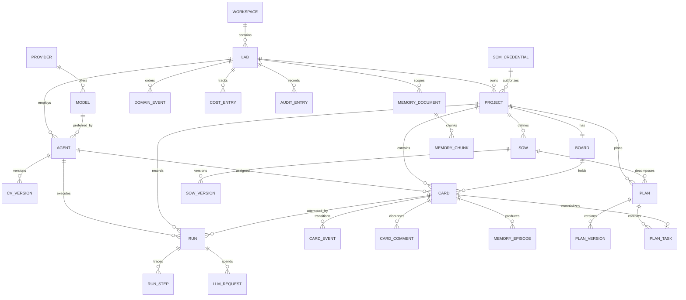

# AI-Lab Logical Data Model

| Field | Value |
|---|---|
| Document | `.docs/DATA-MODEL.md` |
| Version | 1.1.0 |
| Status | Accepted |
| Owner | Dev |
| Model level | Logical (entities, attributes, relationships, business rules, logical access paths) |
| Physical implementation | `.docs/technical-specification/APPENDIX-A-DATABASE.sql` (not repeated here) |
| Alignment rule | This document MUST be updated in the same change as any entity, attribute, relationship, logical index, retention or ownership change. |

This document describes the AI-Lab data model at the **logical level**: what each entity means, which attributes it carries, how entities relate, which business rules apply, and which access paths are required. It intentionally contains **no SQL statements and no physical schema definitions**. The physical implementation is maintained separately in the specification appendix.

If this document and the physical implementation disagree, the physical implementation wins. If the physical implementation and the technical specification disagree, the specification wins and both are corrected through a migration and an ADR.

---

## 1. Model boundaries

AI-Lab v1 is a modular monolith deployed as a small set of runtime services. The logical model is partitioned by **bounded context**, not by database server. Each context owns its entities and exposes access only through application ports.

| Runtime service | Responsibility | Owned entities |
|---|---|---|
| `web` | Serves the Angular application and proxies the API and realtime channel | None |
| `api` | REST, realtime, validation, projections | None directly; writes through context services |
| `worker` | Scheduler, run pipeline, relay, reflection, maintenance | Delivery runs and steps; Platform events and outbox; Memory compaction; Inventory CV updates; Kanban transitions |
| `runner` | Sandbox control plane | None; sandboxes are ephemeral |
| `postgres` | Durable system of record | All contexts |
| `redis` | Cache, rate limits, locks, presence, ephemeral messaging | Ephemeral only; never authoritative |

### 1.1 Context ownership

| Context | Owns | Publishes | Consumes |
|---|---|---|---|
| **Platform / Tenancy** | Workspace, global settings, maintenance schedule, audit, cost ledger, LLM request ledger, outbox, domain event log | `system.*` | All domain events for audit and relay |
| **Lab** | Lab | `lab.*` | `inventory.agent.*` |
| **Inventory** | Provider, model, SCM credential, character, agent, CV version, project | `inventory.*` | None |
| **Knowledge / Memory** | Memory document, memory chunk, memory episode | `memory.*` | `delivery.run.completed` |
| **Kanban** | Board, card, card event, card comment | `kanban.*` | `inventory.project.connected`, `delivery.*` |
| **Delivery** | SOW, SOW version, plan, plan version, plan task, run, run step, decision | `delivery.*` | `kanban.card.moved` |
| **SCM integration** | GitHub webhook delivery | `delivery.pr.*` through Delivery | GitHub webhooks |

### 1.2 Ownership versus reference

A context may hold a reference to an entity owned by another context to preserve referential integrity. For example, a card references its assignee agent. The reference does **not** grant permission to read or modify the agent entity in a write path. Cross-context reads go through query ports; cross-context effects go through domain events.

Reporting views may combine entities from several contexts. Those views are read-only, owned by Platform, and never used for writes.

---

## 2. Logical modeling conventions

| Convention | Rule |
|---|---|
| Identifier | Every entity has an opaque, globally unique identifier generated by the application. Identifiers are never reused. |
| Human key | A card also has a human-readable key composed of the project key prefix and a per-project sequence. The key is immutable. |
| Time | All timestamps are UTC instants generated by the server. Local time is a presentation concern only. |
| Money | Monetary amounts are integer micro-units of US dollars. Monetary arithmetic is never performed with floating point. |
| Enumeration | Statuses, priorities, roles and estimates are closed value sets. New values require a specification change and an ADR. |
| Structured document | Story, settings, SOW content, plan graph, event payloads and blocked reasons are structured documents validated against an explicit schema. |
| Soft delete | Only agents, projects and labs can be retired or archived. Other entities are deleted or retained according to policy. |
| Audit fields | Every entity records creation time. Mutable entities record update time and a version for optimistic concurrency. |
| Referential integrity | Every relationship has an explicit deletion behavior. Orphan records are never allowed. |
| Tenancy | A workspace is the tenancy root. A lab belongs to one workspace. v1 is single-tenant but the model is forward-compatible. |
| Secrets | Secret values are represented by an encrypted payload, a nonce reference, a key version and a last-four display value. The plaintext secret is never part of the logical model. |

---

## 3. Global relationship overview

---

## 4. Platform / Tenancy context

### 4.1 Purpose

Platform owns tenancy, global settings, scheduled maintenance, audit, cost accounting, the durable event log, the transactional outbox and the LLM request ledger. It is the cross-cutting context. Other contexts contribute audit, cost and event records in their own transactions, but Platform defines their meaning and retention.

### 4.2 Entities

| Entity | Meaning | Key attributes | Relationships | Business rules |
|---|---|---|---|---|
| Workspace | Tenancy root. v1 seeds one default workspace. | Identifier, name, slug, settings | Contains many labs | Slug is unique. A workspace cannot be deleted while it contains active labs. |
| Global setting | Key-value configuration not owned by a lab. | Key, structured value | None | The key is unique. The value is validated against a schema. |
| Maintenance job | Registry and schedule of a recurring job. | Identifier, name, schedule expression, enabled flag, last run, next run, last status | None | The name is unique. Every scheduled job has an observable last and next run. |
| Audit entry | Append-only record of a sensitive action. | Identifier, lab reference, actor type, actor reference, action, target type, target reference, before state, after state, correlation reference, timestamp | Belongs to zero or one lab | Audit entries are never updated or deleted in normal operation. |
| Cost entry | Monetary ledger entry for LLM or sandbox spend. | Identifier, lab reference, project reference, card reference, agent reference, run reference, source, amount in micro-USD, occurrence time | Belongs to a lab; optionally references project, card, agent and run | Source is one of LLM, sandbox or other. References are cleared when the referenced entity is deleted. |
| LLM request | One recorded model call with usage and cost. | Identifier, lab reference, provider reference, model reference, optional card, agent and run references, purpose, prompt fingerprint, token counts, cost, latency, status, correlation reference, timestamp | Belongs to a lab; references a provider and a model | Provider and model are required. Purpose and status are closed value sets. |
| Outbox entry | Pending domain event to publish. | Identifier, aggregate type, aggregate reference, event type, payload, headers, availability time, publication time, attempt count, last error | None | An entry is created in the same unit of work as the state change it describes. Published entries are retained for a short period and then removed. |
| Domain event | Durable, ordered event history. | Identifier, lab reference, sequence number, event type, aggregate type, aggregate reference, actor type, actor reference, payload, schema version, occurrence time | Belongs to a lab | The pair of lab and sequence number is unique. Sequence numbers are strictly increasing per lab. Events are immutable. |

### 4.3 Logical access paths

| Access path | Purpose |
|---|---|
| Workspace and lab slug | Resolve a lab during navigation and API calls. |
| Unpublished outbox entries by availability | Relay only pending work and preserve ordering. |
| Domain events by lab and sequence | Ordered replay for realtime clients and audit. |
| Domain events by type and time | Operational investigation. |
| Domain events by aggregate | Rebuild one aggregate's history. |
| Audit entries by lab and time | Lab audit view, newest first. |
| Audit entries by action and time | Security review. |
| Cost entries by lab and time | Spend dashboard and trend. |
| Cost entries by card | Per-card budget reconciliation. |
| LLM requests by lab and time | Usage and cost dashboard. |
| LLM requests by card and by run | Per-card and per-run cost drill-down. |

### 4.4 Lifecycle

- Outbox entries are created with the state change and removed after successful publication and a short retention period.
- Domain events are retained for 180 days, archived, then removed.
- Audit entries are retained for two years and are append-only.
- Cost and LLM ledgers are retained for two years; prompt and response payloads are retained for 90 days.

---

## 5. Lab context

### 5.1 Purpose

The Lab context owns the workspace-level configuration that agents and projects belong to: identity, autonomy, budget and settings.

### 5.2 Entities

| Entity | Meaning | Key attributes | Relationships | Business rules |
|---|---|---|---|---|
| Lab | Top-level workspace for agents, projects and memory. | Identifier, workspace reference, name, slug, autonomy level, monthly budget, settings, archive time | Belongs to one workspace; contains many agents, projects, memory documents, events, cost entries and audit entries | Slug is unique within a workspace. Autonomy level is one of four ordered levels. Budget is non-negative. Settings are validated against a schema. A lab must have exactly one active Tech Lead. |

### 5.3 Logical access paths

| Access path | Purpose |
|---|---|
| Workspace and active state | List active labs in the selector. |

### 5.4 Lifecycle

Archiving a lab makes it read-only and pauses its agents. The lab, its projects, agents, memory and history are retained. Deletion is a separate, audited operation.

---

## 6. Inventory context

### 6.1 Purpose

Inventory is the authoritative catalog of LLM providers and models, SCM credentials, characters, agents, CVs and projects. It owns identity and credentials for everything the rest of the product references.

### 6.2 Entities

| Entity | Meaning | Key attributes | Relationships | Business rules |
|---|---|---|---|---|
| Provider | Configured LLM vendor endpoint. | Identifier, workspace reference, name, kind, base URL, encrypted secret, status, rate limits, timeout | Belongs to one workspace; offers many models | Name is unique within a workspace. Kind is DeepSeek in v1. The secret is write-only. A provider with referenced models is disabled, not deleted. |
| Model | Model offered by a provider. | Identifier, provider reference, API name, display name, context limit, output limit, tool support, reasoning support, vision support, input cost, output cost, default temperature, default reasoning effort, default flag, escalation flag, status | Belongs to one provider; may be preferred by many agents | API name is unique within a provider. Exactly one default model per provider. At most one escalation model. Costs are non-negative. |
| SCM credential | GitHub access credential. | Identifier, workspace reference, name, kind, username, encrypted secret, scopes, status, last verification | Belongs to one workspace; authorizes many projects | Name is unique within a workspace. The secret is write-only. A project must use an active credential. |
| Character | Fixed visual and behavioral persona. | Identifier (stable slug), display name, archetype, sprite key, palette, speech style, active flag | Referenced by many agents | The roster is finite. Characters affect tone and visuals only, never permissions. |
| Agent | Persistent AI employee. | Identifier, lab reference, name, role, character reference, description, model preference reference, autonomy level, status, maximum concurrent cards, current CV version, retirement time | Belongs to one lab; has many CV versions, assigned cards, reviewed cards, runs and memory records | Name is unique within a lab. Exactly one active Tech Lead per lab. Role is one of four closed values. Description length is bounded. A retired agent cannot be assigned new work. |
| CV version | Immutable snapshot of an agent's skills and evidence. | Identifier, agent reference, version number, structured CV, summary, author kind, optional run reference, creation time | Belongs to one agent | Version numbers are unique and monotonic per agent. Snapshots are immutable. Skill proficiency is bounded. Evidence must reference an existing run or card. |
| Project | Software project connected to GitHub. | Identifier, lab reference, name, slug, key prefix, description, source kind, source reference, default branch, credential reference, status, card sequence counter, settings | Belongs to one lab; has one board, many cards, SOWs, plans, runs and memory documents | Slug, key prefix and source reference are unique within a lab. Key prefix is immutable after the first card. Archive makes the project read-only. |

### 6.3 Logical access paths

| Access path | Purpose |
|---|---|
| Active agents by lab | Team list and capacity calculation. |
| Active Tech Lead by lab | Enforce exactly one active Tech Lead. |
| CV versions by agent and version number | Current CV and history. |
| Active projects by lab | Project list and navigation. |
| Default model by provider | Enforce one default model per provider. |
| Provider and model name within scope | Resolve configuration and prevent duplicates. |

### 6.4 Credential lifecycle

A provider or SCM secret is encrypted at rest, bound to its entity and key version, and displayed only as its last four characters. Rotation creates a new encrypted payload, verifies it, and retires the old key version. No secret is ever returned by an API, written to a log, included in an event or made available to a sandbox.

---

## 7. Knowledge / Memory context

### 7.1 Purpose

Memory gives agents durable, scoped, cited context at three levels: lab, project and agent. It combines semantic documents, vector chunks and episodic records.

### 7.2 Entities

| Entity | Meaning | Key attributes | Relationships | Business rules |
|---|---|---|---|---|
| Memory document | Versioned document in exactly one scope. | Identifier, lab reference, optional project reference, optional agent reference, scope, kind, title, content, content fingerprint, source reference, author kind, pinned flag, version number, creation and update times | Belongs to one lab and exactly one scope; has many chunks | Scope is lab, project or agent. A lab document has no project or agent reference; a project document has a project and no agent; an agent document has an agent and no project. Kind is a closed set. Content is bounded and fingerprintable. |
| Memory chunk | Retrieval unit derived from a document. | Identifier, document reference, lab reference, optional project reference, optional agent reference, scope, ordinal, text, token count, 384-dimensional embedding, metadata, creation time | Belongs to one document and one scope | Ordinal is unique within a document. The embedding is always present and always 384-dimensional. Text is the retrieval unit. |
| Memory episode | Raw episodic record from a run or tool. | Identifier, lab reference, optional project, agent, card and run references, kind, content, metadata, compaction time, creation time | Belongs to one lab; optionally references project, agent, card and run | Kind is one of event, transcript, tool call or lesson. Episodes are compacted into summary documents and then retained or removed by policy. |

### 7.3 Logical access paths

| Access path | Purpose |
|---|---|
| Documents by scope and owner | List and filter documents without crossing scopes. |
| Documents by content fingerprint | Deduplicate identical content. |
| Documents by title and content text | Full-text discovery. |
| Chunks by scope and owner | Restrict retrieval before ranking. |
| Chunks by embedding similarity | Approximate nearest-neighbor retrieval. |
| Chunks by text terms | Lexical half of hybrid retrieval. |
| Episodes by lab and time | Chronological review and compaction. |
| Uncompacted episodes by time | Find episodes ready for compaction. |

### 7.4 Lifecycle

- Raw episodes are retained for 180 days. Episodes older than 30 days are summarized into semantic documents.
- Superseded chunks are removed after cache invalidation.
- Pinned documents are exempt from retention.
- A change of embedding model requires a new logical collection, a backfill, an evaluation and a swap, governed by an ADR.

---

## 8. Kanban context

### 8.1 Purpose

Kanban is the authoritative model of work: one board per project, cards with a canonical user story, an immutable transition log and comments.

### 8.2 Entities

| Entity | Meaning | Key attributes | Relationships | Business rules |
|---|---|---|---|---|
| Board | One board per project. | Identifier, project reference, creation and update times | Belongs to one project; contains many cards | A project has exactly one board. The board exists while the project exists. |
| Card | Unit of work with a six-column state. | Identifier, board reference, project reference, human key, per-project sequence, title, structured story, column, priority, estimate, labels, assignee reference, reviewer reference, due time, blocked reason, source, creator agent reference, parent card reference, SOW reference, plan task reference, budget, spent amount, merge reference, pull request reference, branch name, refinement flag, version, creation and update times | Belongs to one board and one project; has many events, comments, runs and memory episodes; may have a parent card; may reference a SOW and a plan task | Human key and per-project sequence are unique. Column and priority are closed sets. A card in the blocked column has a structured reason. A card in ready has an assignee, a future due time, an estimate and a priority other than will-not-do. A card in review has a reviewer and a pull request. A card in done has a merge reference. Reviewer differs from assignee. |
| Card event | Immutable transition and audit record. | Identifier, card reference, per-card sequence, event type, source column, target column, actor type, actor reference, reason, metadata, timestamp | Belongs to one card | Per-card sequence is unique and strictly increasing. Events are immutable. The card column is a projection of the latest event. |
| Card comment | Human or agent discussion on a card. | Identifier, card reference, author type, author reference, body, timestamp | Belongs to one card | Body length is bounded. Comments are immutable; an edit creates a new comment linked to the original. |

### 8.3 Logical access paths

| Access path | Purpose |
|---|---|
| Cards by board and column | Load a board grouped by column. |
| Cards by assignee in active columns | Agent workload and work-in-progress checks. |
| Cards by due time in active columns | Overdue scan. |
| Cards by parent | Reopen and split lineage. |
| Cards by SOW | Traceability from SOW to cards. |
| Cards by label | Filtering. |
| Cards by title similarity | Search and duplicate detection. |
| Card events by card and sequence | Replay history in order. |
| Card events by time | Global activity feed. |
| Comments by card | Discussion in chronological order. |

### 8.4 State model

The card entity records the current column, but the authoritative history is the ordered card event log. Every transition is validated against the allowed matrix, the Definition of Ready or Done, work-in-progress limits and separation of duties. The blocked state is a structured flag, not a column.

---

## 9. Delivery context

### 9.1 Purpose

Delivery owns the lifecycle artifacts: SOWs, plans, WBS tasks, runs, run steps and decisions. It connects an idea to a SOW, a SOW to a plan, a plan to cards, and cards to runs and merges.

### 9.2 Entities

| Entity | Meaning | Key attributes | Relationships | Business rules |
|---|---|---|---|---|
| SOW | Statement of Work for a project. | Identifier, project reference, lab reference, title, status, current version, approval time, approver, creator agent reference, creation and update times | Belongs to one project; has many versions; may generate many plans | Status is draft, in review, approved, superseded or rejected. An approved SOW is immutable; a change creates a new version. |
| SOW version | Immutable SOW snapshot. | Identifier, SOW reference, version number, structured document, rendered document, content fingerprint, change note, creation time | Belongs to one SOW | Version numbers are unique per SOW. Content is validated against the SOW schema. |
| Plan | Work breakdown plan. | Identifier, project reference, optional SOW reference, title, status, current version, creator agent reference, creation and update times | Belongs to one project; may reference a SOW; has many versions and tasks | Status is draft, approved, materialized or superseded. The plan graph must be acyclic. |
| Plan version | Immutable plan snapshot. | Identifier, plan reference, version number, structured graph, rendered document, creation time | Belongs to one plan | Version numbers are unique per plan. The graph is validated before approval. |
| Plan task | WBS node. | Identifier, plan reference, plan version, task key, title, description, role, estimate, milestone, dependency keys, deliverables, acceptance criteria | Belongs to one plan version | Task key is unique within a plan version. The estimate is a Fibonacci value. Dependencies form an acyclic graph. |
| Run | One attempt by an agent to execute one card. | Identifier, card reference, project reference, lab reference, agent reference, attempt number, status, lease reference, sandbox reference, heartbeat time, token counts, cost, error code, result summary, pull request reference, merge reference, correlation reference, creation and update times | Belongs to one card, project, lab and agent; has many steps and LLM requests | Attempt numbers are unique per card. Status is queued, running, succeeded, failed, cancelled or timed out. A completed attempt is immutable. |
| Run step | Ordered trace of a run. | Identifier, run reference, sequence number, step type, summary, structured detail, token counts, cost, duration, timestamp | Belongs to one run | Sequence is unique per run and strictly increasing. Step type is a closed set. |
| Decision | Decision log for humans and agents. | Identifier, lab reference, optional project, card and run references, title, context, decision, alternatives, consequences, reversible flag, actor type, actor reference, timestamp | Belongs to one lab; optionally references project, card and run | Decisions are immutable. A reversal creates a new decision linked to the original. |

### 9.3 Logical access paths

| Access path | Purpose |
|---|---|
| SOWs by project and creation time | Project SOW list, newest first. |
| Plans by project and creation time | Project plan list. |
| Plan tasks by plan version | Load a plan version's tasks. |
| Runs by card and attempt | Run history, newest attempt first. |
| Runs by agent and status | Agent workload and failure review. |
| Running runs by heartbeat | Detect stale runs. |
| Runs by lab and creation time | Lab run list and run funnel. |
| Run steps by run and sequence | Stream a run trace in order. |
| Decisions by project and time | Decision history. |

### 9.4 Lifecycle

- SOW and plan versions are immutable. Approval freezes them; supersession creates a new version.
- Materialization creates cards with SOW and plan task references and is idempotent by plan version and task key.
- Runs are append-only attempts. A retry creates a new attempt; a completed attempt is never mutated.
- Run steps are retained for 180 days, then summarized into the run result summary.
- Decisions are retained for two years.

---

## 10. SCM integration context

### 10.1 Purpose

The SCM integration context ingests GitHub webhooks idempotently and reconciles external repository state with Delivery and Kanban.

### 10.2 Entities

| Entity | Meaning | Key attributes | Relationships | Business rules |
|---|---|---|---|---|
| Webhook delivery | Idempotency and processing state for one webhook delivery. | Delivery identifier, event, action, payload fingerprint, receipt time, processing time, status, error | None | The delivery identifier is unique. The payload is verified before acceptance. Duplicate deliveries are acknowledged without reprocessing. Status is received, processed, ignored or failed. |

### 10.3 Lifecycle

Deliveries are verified, stored, processed asynchronously and retried up to five times with backoff. Processed deliveries are retained for 30 days.

---

## 11. Cross-context interactions

### 11.1 Interaction matrix

| Producer | Event or operation | Consumer | Effect |
|---|---|---|---|
| Inventory | Project created | Kanban | Creates the project board idempotently. |
| Inventory | Agent created | Lab, Kanban, Office | Updates team capacity and the office. |
| Inventory | Agent CV updated | Office, Memory | Updates CV display and agent-scope retrieval. |
| Lab | Agent status changed | Office, Scheduler | Updates animation and eligibility. |
| Kanban | Card moved | Delivery | Starts or updates a run; records review and merge state. |
| Delivery | Run queued | Office, Metrics | Shows activity and queue depth. |
| Delivery | Run step recorded | Office | Drives agent animation and the live inspector. |
| Delivery | Run completed | Memory, Inventory, Metrics | Triggers reflection, CV update and cost rollup. |
| Delivery | Pull request opened | Kanban | Records pull request and branch on the card. |
| Delivery | Review submitted | Kanban | Moves the card to done or back to doing. |
| Delivery | Merge completed | Kanban, Office | Records merge reference, celebrates and closes the card. |
| Memory | Document created | Search cache | Invalidates retrieval cache for the scope. |
| Platform | Budget exhausted | Scheduler, Office | Pauses the lab and shows the banner. |
| SCM | Pull request merged externally | Delivery, Kanban | Reconciles an externally merged pull request. |

### 11.2 Read and write rules

1. A context writes only its owned entities. Cross-context writes happen through events.
2. A context reads another context only through a query port that returns a view model. It does not navigate to the other context's entities in a write path.
3. References across contexts are allowed for referential integrity. They do not grant read or write permission.
4. Platform-owned reporting views may combine contexts and are read-only.
5. Every cross-context effect is idempotent by event identifier and, for external effects, by run, operation and target.
6. Ephemeral storage is never used to reconstruct domain state; a cold cache must produce the same result.

### 11.3 Example flows

**Idea to card**

1. The API resolves the lab and project through Inventory.
2. Delivery stores the idea and asks the model to produce candidate cards.
3. Delivery asks Kanban to create cards in the initial column.
4. Kanban records the cards, their events and an outbox entry in one unit of work.
5. Platform relays the event; the office and dashboard update.

**Card to merge**

1. A ready card is leased by the worker, which creates a run and moves the card to doing.
2. Delivery records run steps and LLM requests in Platform.
3. On success, Delivery opens a pull request through the SCM adapter.
4. Kanban moves the card to review; QA submits a verdict.
5. Delivery merges and records the merge reference; Kanban moves the card to done.
6. Delivery triggers reflection; Inventory appends CV evidence; Memory stores lessons.

**Memory retrieval**

1. Delivery requests retrieval with lab, project and agent scope.
2. Memory filters by scope first, then ranks by vector similarity, text relevance, recency and scope boost, and returns citations.
3. Delivery injects the chunks into the prompt inside untrusted blocks.
4. The retrieval and its citations are recorded for audit.

---

## 12. Logical access paths and index rationale

| Area | Logical access path | Rationale |
|---|---|---|
| Labs | Active labs by workspace | Lab selector. |
| Agents | Active agents by lab | Team list and capacity. |
| Agents | Active Tech Lead by lab | Enforce the Tech Lead invariant. |
| CV | CV versions by agent and version | Current CV and history. |
| Projects | Active projects by lab | Project navigation. |
| Models | Default model by provider | Enforce one default per provider. |
| Cards | Cards by board and column | Board load. |
| Cards | Cards by assignee in active columns | Workload and work-in-progress. |
| Cards | Cards by due time in active columns | Overdue scan. |
| Cards | Cards by parent | Reopen and split lineage. |
| Cards | Cards by SOW | Traceability. |
| Cards | Cards by label | Filtering. |
| Cards | Cards by title similarity | Search and duplicate detection. |
| Card events | Events by card and sequence | Ordered history. |
| Card events | Events by time | Activity feed. |
| Comments | Comments by card | Discussion. |
| SOW | SOWs by project and time | Project list. |
| Plans | Plan tasks by plan version | Plan load. |
| Runs | Runs by card and attempt | History. |
| Runs | Runs by agent and status | Workload and failure review. |
| Runs | Running runs by heartbeat | Stale run detection. |
| Runs | Runs by lab and time | Lab funnel. |
| Run steps | Steps by run and sequence | Ordered trace. |
| Decisions | Decisions by project and time | Decision history. |
| LLM requests | Requests by lab and time, card and run | Cost and usage drill-down. |
| Cost | Cost entries by lab and time, card | Spend dashboard and reconciliation. |
| Events | Events by lab and sequence, type and time, aggregate | Replay, operations, aggregate rebuild. |
| Outbox | Pending entries by availability | Relay efficiency. |
| Audit | Audit entries by lab and time, action and time | Audit and security review. |
| Webhooks | Unprocessed deliveries by receipt time | Reliable async processing. |
| Memory documents | Documents by scope, fingerprint, text | Scope list, deduplication, discovery. |
| Memory chunks | Chunks by scope, embedding similarity, text terms | Scoped hybrid retrieval. |
| Memory episodes | Episodes by lab and time, uncompacted by time | Review and compaction. |

---

## 13. Query and access patterns

1. Board load uses the board and column access path and returns summary views rather than full stories.
2. Assignment and workload use the assignee access path restricted to active columns.
3. Overdue scans use the due-time access path restricted to active columns.
4. Card history uses the per-card sequence and is append-only.
5. Retention and activity feeds use time-ordered access paths with a bounded range.
6. Retrieval filters by scope before ranking. Similarity search is approximate and tuned for recall and latency.
7. Cost dashboards aggregate the cost ledger by day and group. Pre-aggregation is allowed only in read-only reporting views.
8. A new heavy access path requires a query plan review and a recorded benchmark before it is accepted.
9. No unbounded result sets, no full-table scans in request paths and no dynamic navigation across contexts in write paths.

---

## 14. Concurrency, units of work and integrity

1. Aggregates use optimistic concurrency through a version attribute. A stale write is rejected with a conflict and the current state.
2. Card human keys use the project sequence counter inside the card creation unit of work. Uniqueness rules are the final guard.
3. Event sequences use a per-lab monotonic sequence assigned inside the unit of work that writes the event.
4. A run lease is exclusive per card and is claimed atomically. A stale lease is recovered, not duplicated.
5. Outbox entries are written in the same unit of work as the state change. Publication is at least once and consumers are idempotent.
6. Conflicting concurrent writes are retried a bounded number of times with jitter.
7. A nightly integrity check verifies card projection, run state, event continuity, outbox lag, embedding dimensions, budget reconciliation and readiness consistency.
8. No unit of work is held open across a model call, an SCM call or a sandbox call.

---

## 15. Retention and archival

| Data | Retention | Mechanism |
|---|---|---|
| Domain events | 180 days | Archive, then remove. |
| Card events | 2 years | Archive after 1 year; keep the latest per card. |
| Run steps | 180 days | Summarize into the run result, then remove raw steps. |
| Memory episodes | 180 days raw | Daily compaction at 30 days into summary documents. |
| LLM requests | 90 days payload, 2 years ledger | Redact and remove payloads; keep aggregates. |
| Audit entries | 2 years | Archive; append-only. |
| Outbox entries | 7 days after publication | Remove. |
| Webhook deliveries | 30 days | Remove processed entries. |

Retention jobs are idempotent, bounded and observable. Destructive jobs require a dry run and a verified backup.

---

## 16. Security and data classification

| Class | Examples | Control |
|---|---|---|
| Secret | Provider and SCM secrets, master key | Encrypted at rest, write-only, never logged, never in prompts or sandboxes. |
| Sensitive | Prompts, responses, repository content, memory content | Redaction, scoped access, retention, no personal data in telemetry. |
| Internal | Cards, runs, decisions, cost | Lab-scoped access and audit. |
| Public | Character catalog, static UI copy | No special control. |

Deleting a lab removes its documents, chunks, episodes, cards, runs and memory. The operation is asynchronous, audited and verified.

---

## 17. Keeping this document aligned

This document is part of the change surface. The following rule is binding:

1. Any change to an entity, attribute, relationship, logical access path, retention rule or ownership MUST update this document in the same change.
2. Update the relevant entity table, relationship paragraph, access-path table and interaction matrix.
3. The physical implementation is maintained separately. This document describes the logical model and does not carry SQL syntax.
4. Add or update an ADR when the change is architectural or irreversible.
5. Update `AGENTS.md` if the documentation index changes.
6. Run `scripts/harness-lint.sh` and the data-platform tests before reporting completion.

### 17.1 Change checklist

- [ ] Entity meaning updated.
- [ ] Attributes and business rules updated.
- [ ] Relationships and cardinalities updated.
- [ ] Logical access paths and rationale updated.
- [ ] Retention and lifecycle updated.
- [ ] Cross-context interactions updated.
- [ ] Physical implementation reference updated when required.
- [ ] ADR created or updated when required.
- [ ] `AGENTS.md` index updated if needed.
- [ ] `scripts/harness-lint.sh` green.

---

## 18. References

- `./technical-specification/APPENDIX-A-DATABASE.sql` (physical implementation)
- `./technical-specification/AI-LAB-TECHNICAL-SPECIFICATION.md` §14
- `./technical-specification/APPENDIX-B-CONTRACTS.md`
- `./sow/WP-04-DATA-PLATFORM.md`
- `./sow/WP-06-DOMAIN-KERNEL.md`
- `./sow/WP-08-LAB-MEMORY.md`
- `./sow/WP-09-KANBAN-ENGINE.md`
- `./sow/WP-13-ORCHESTRATION.md`
- `./CONSTITUTION.md`, `./PRINCIPLES.md`, `./STACK.md`
- `./adr/registry.md`
- `../AGENTS.md`
