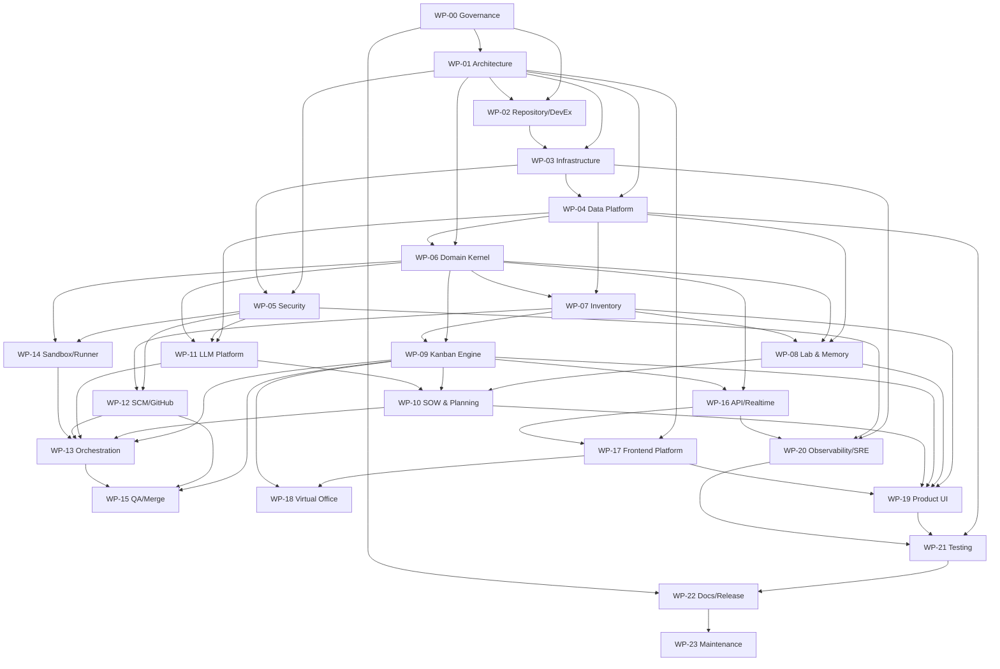

# AI-Lab — Statement of Work (SOW) & Work Package Index

| Field | Value |
|---|---|
| Document ID | `AILAB-SOW-001` |
| Title | AI-Lab — Autonomous Software Delivery Lab — Statement of Work |
| Version | 1.0.0 |
| Status | **BASELINED** |
| Date | 2026-11-07 |
| Source specification | `../technical-specification/AI-LAB-TECHNICAL-SPECIFICATION.md` + Appendices A–D |
| Owner | Tech Lead (delivery authority) |
| Approver | Human Operator (final acceptance) |
| Audience | Implementing agents, Tech Lead, Analyst, Dev, QA, reviewers, operators |
| Normative language | RFC 2119 / RFC 8174 (`MUST`, `MUST NOT`, `SHOULD`, `MAY`) |
| Status vocabulary | `ready` · `progress` · `done` (exact semantics in §6) |

> **Binding rule.** This SOW decomposes the approved technical specification into **24 independent work packages (WPs)**. Each WP is a self-contained contract: objective, scope, engineering detail, deliverables checklist, task breakdown, acceptance criteria and DoD. Every implementation card MUST belong to exactly one WP and cite its `WP-XX` and the requirement IDs it satisfies. If this SOW and the technical specification ever conflict, the technical specification wins and this SOW MUST be corrected through change control (§12).

---

## 1. Purpose and how to use this document

1. This file is the **index and control plane** of the delivery program. It defines the delivery model, status rules, dependencies, milestones and cross-WP contracts. It intentionally does **not** duplicate the engineering detail held in each WP file.
2. Each WP file (`WP-XX-*.md`) is the **executable contract** for a coherent slice of the product. It contains the full technical specification for that slice, a checklist of deliverables, a task breakdown, acceptance criteria and a WP-level Definition of Done.
3. Work is pulled, not pushed. An agent or human MUST NOT start a WP until its dependencies are `done` (or an explicit, recorded waiver exists) and its status has moved to `progress`.
4. Only one WP may be in `progress` per agent at a time (WIP = 1), and no more than **two WPs** may be in `progress` program-wide unless the Tech Lead records a capacity exception.
5. Every deliverable is a checkbox. A WP is `done` only when every box is checked, acceptance evidence is linked, and the WP DoD is signed off.
6. The status field at the top of each WP file is authoritative. The index table in §7 is a projection and MUST be updated in the same change as the WP file.

---

## 2. Product context (what is being built)

AI-Lab takes a raw idea through the complete software delivery lifecycle and maintains the result:

```
IDEA → SOW → PLAN/WBS → KANBAN TASKS → EXECUTION (agents + tools)
     → REVIEW → MERGE → RELEASE → MAINTENANCE → LEARNING (CV + memory)
```

The product is a single-operator, local-first web application composed of:

- a **Rust backend** (API + worker + scheduler + runner) using axum/tokio/sqlx;
- an **Angular 22** frontend (zoneless + signals) including a Canvas 2D 16-bit virtual office;
- **PostgreSQL 18 + pgvector** as the only durable system of record;
- **Redis 8.8** for cache, rate limits, locks and ephemeral pub/sub;
- **DeepSeek** as the only LLM provider in v1 (`deepseek-flash` default, `deepseek-v4-pro` escalation);
- **GitHub** as the only SCM provider in v1 (fine-grained PAT behind an `ScmProvider` port);
- **Docker Compose** as the supported runtime.

The product is **login-less for the local operator**, **loopback by default**, **security-first**, and **auditable by construction**. It is delivered as a managed team of persistent agents (Tech Lead, Analyst, Dev, QA) with fixed roles, a finite 10-character roster, evolving CVs and three-tier memory.

---

## 3. Scope

### 3.1 In scope

All capabilities defined in `AILAB-SPEC-001` §2.1: inventory, labs, three-tier memory, Agile Kanban, SOW/plan/materialization, agent execution, GitHub integration, real-time UI, pixel office, maintenance automation, observability, security, testing, documentation and release.

### 3.2 Out of scope (v1, binding)

- Multi-user authentication, RBAC, SSO, billing, multi-tenancy beyond the `workspace_id` forward-compatibility column.
- Non-DeepSeek LLM adapters in the shipped UI (the port MUST exist; only DeepSeek is wired).
- Non-GitHub SCM adapters in the shipped UI (the port MUST exist; only GitHub is wired).
- Kubernetes/Helm operators; Docker Compose is the supported deployment.
- Mobile-native apps; responsive web is required, phone is read-mostly.
- Arbitrary code execution outside the sandbox.
- Free-form agent-to-agent chat beyond the structured `Handoff` contract.
- Payments, invoicing, time tracking, HR features.

### 3.3 Assumptions

- Host: Docker Engine ≥ 27, Compose ≥ 2.30, ≥ 4 vCPU, ≥ 8 GB RAM, ≥ 20 GB free disk.
- Outbound HTTPS to `api.deepseek.com`, `api.github.com`, `github.com`.
- Operator supplies `AILAB_MASTER_KEY`, a DeepSeek API key and a GitHub fine-grained PAT.
- English is the canonical language for code, docs, commits, UI copy and generated artifacts.
- The deterministic demo seed (`make seed-demo`) is the reference environment for demos and tests.

---

## 4. Delivery principles (normative)

These principles are part of the acceptance criteria, not slogans. Every WP MUST demonstrate compliance in its deliverables.

### 4.1 Lean

- **L-01 Eliminate waste:** no unrequested features, no speculative abstraction, no duplicate sources of truth. Every artifact has one owner and one canonical location.
- **L-02 Limit WIP:** WIP = 1 per agent; max 2 WPs in `progress` program-wide; Kanban WIP limits are enforced by the engine, not by convention.
- **L-03 Pull, don't push:** work starts only when capacity exists and dependencies are `done`.
- **L-04 Small batches:** cards > 8 points must be split; PRs > 1,500 changed lines or > 40 files require human confirmation.
- **L-05 Fast feedback:** CI target ≤ 15 minutes for the full pipeline; unit tests ≤ 5 minutes; the local `make check` ≤ 3 minutes.
- **L-06 Built-in quality:** no separate "hardening phase" for correctness. Tests, security scans and contract checks run on every PR.
- **L-07 Optimize the whole:** measure flow (lead time, cycle time, throughput, WIP, blocked time), not individual utilization.
- **L-08 Defer commitment:** estimates are relative; dates are forecasts, not promises. Scope is protected by explicit out-of-scope lists.

### 4.2 Agile

- **A-01 Kanban flow:** no fixed sprints. Continuous flow with explicit columns, WIP limits and policies.
- **A-02 Cadence:** daily async update (blockers, next pull), weekly review (flow metrics + demo of `done` work), milestone gate (acceptance + demo + docs).
- **A-03 Definition of Ready / Done:** enforced by the Kanban engine (`FR-KAN-*`). A card cannot be `READY` without DoR; a WP cannot be `done` without its DoD.
- **A-04 Trunk-based development:** short-lived branches (`ailab/{card_key}-{slug}`), squash merge to `main`, no long-running release branches except documented release cut.
- **A-05 Retrospectives:** after each milestone, produce a retrospective with three actions and owners; tracked as `TODO` cards.
- **A-06 Transparency:** every state change is an immutable event; the board and office are projections of the same domain truth.

### 4.3 Security first

- **S-01 Threat model before build:** each WP with an external surface starts with an abuse-case review; security acceptance criteria are part of the WP.
- **S-02 Secure defaults:** loopback bind, no auth bypass, least privilege, deny-by-default tool policy, read-only root filesystem in the sandbox.
- **S-03 Shift left:** secret scanning, dependency audit, SAST, container scanning and SBOM generation run on every PR and every image build.
- **S-04 Secrets:** AES-256-GCM at rest, never returned by APIs, never logged, never available in the sandbox.
- **S-05 Supply chain:** lockfiles, pinned image digests, `cargo-deny`, `npm audit`, signed SBOMs, no EOL dependencies.
- **S-06 Defense in depth:** input validation at the boundary + domain invariants + database constraints + least-privilege runtime + audit trail.
- **S-07 Prompt injection resistance:** untrusted content is wrapped and never treated as instructions; tool policy is enforced server-side.
- **S-08 Auditability:** every mutation has an actor, a correlation ID, a trace ID and (for agentic work) a `run_id`.

### 4.4 Documentation as code

- Docs live with the code, are reviewed in PRs, are built in CI, and are a release gate.
- Every ADR is immutable once accepted; superseding requires a new ADR.
- Diagrams are source files (Mermaid/Excalidraw) and exported SVGs; screenshots are generated from the deterministic seed.

---

## 5. Operating model and governance

### 5.1 Roles and RACI

| Activity | Tech Lead | Analyst | Dev | QA | Human Operator |
|---|---|---|---|---|---|
| SOW / WP decomposition | A | R | C | C | I |
| Architecture decisions (ADR) | A | C | R | C | I |
| Card refinement & DoR | A/R | C | C | C | I |
| Implementation | C | I | R | I | I |
| Independent verification | C | I | I | R/A | I |
| Merge | R/A | I | C | C | C |
| Budget / autonomy changes | C | I | I | I | A |
| Milestone acceptance | R | C | C | R | A |
| Release | R | C | R | R | A |

`R` = responsible, `A` = accountable, `C` = consulted, `I` = informed. The Tech Lead is the single delivery authority. The Human Operator is the final acceptor and the only actor allowed to change budgets, autonomy or exposure mode.

### 5.2 Ceremonies and cadence

| Ceremony | When | Duration | Output | Owner |
|---|---|---|---|---|
| Async daily | Every working day, 09:00 UTC | ≤ 10 min reading | Yesterday / today / blockers | Each agent |
| Flow review | Weekly, Monday 10:00 UTC | 30 min | Flow metrics, blockers, pull order | Tech Lead |
| Milestone demo | End of each milestone | 30 min | Demo of `done` scope + acceptance evidence | Tech Lead + QA |
| Retrospective | After each milestone | 30 min | 3 actions with owners → `TODO` cards | Tech Lead |
| Change control board | As needed | 15 min | Approved/rejected change requests | Tech Lead + Operator |

### 5.3 Flow metrics (measured, not estimated)

- Lead time (idea → Done), cycle time (Ready → Done), throughput (cards/week), WIP, blocked time, flow efficiency (active time / lead time), rework rate, escaped defects, cost per completed card.
- Targets: p50 cycle ≤ 45 min, p95 ≤ 4 h; rework ≤ 10%; escaped P0/P1 = 0; autonomous success ≥ 85%.
- Metrics are derived from `card_events`, `runs`, `llm_requests`, `cost_ledger`; they are displayed on the dashboard and reviewed weekly.

### 5.4 Evidence rules

Every `done` claim MUST link to at least one of: a merged PR, a test report, a screenshot/GIF, a benchmark result, a security scan report, an ADR, or a run ID. "It works" is not evidence.

---

## 6. Work package status model

Only three statuses exist. `blocked` is a **flag**, not a status. A blocked WP remains in its current status with a blocker note and an escalation.

| Status | Definition | Entry criteria | Exit criteria |
|---|---|---|---|
| `ready` | Scoped, estimated, dependencies defined; not started | Objective, scope, deliverables, tasks, acceptance criteria and DoD are complete; dependencies are `done` or explicitly waived | First deliverable moved to in-progress and a `progress` log opened |
| `progress` | Active work; at least one deliverable in progress | WP status updated; owner assigned; WIP slot acquired; progress log created | Every deliverable checked; acceptance evidence linked; WP DoD satisfied; Tech Lead + QA sign-off |
| `done` | Fully delivered and verified | All deliverables checked; acceptance tests pass; docs updated; no open P0/P1; change record closed | Reopened only through change control; status becomes `progress` with a new version |

**Rules**

- `ST-01`: Initial status of every WP in this baseline is `ready`.
- `ST-02`: Status transitions are `ready → progress → done` only. Skipping is forbidden. Reopening `done → progress` requires an approved change request.
- `ST-03`: A WP in `progress` MUST have a progress log entry at least every working day; no update for 3 days triggers an escalation.
- `ST-04`: A WP in `progress` with an unresolved blocker is flagged `blocked=true` and includes: blocker category (`dependency|clarification|external|risk|budget|policy`), owner, impact, next action, ETA.
- `ST-05`: The index status and the WP file status MUST match; CI checks this (`scripts/sow-lint`).

---

## 7. Work package index

All WPs start as **ready**. Estimates are relative story points (Fibonacci). `M` is the primary milestone; a WP may span adjacent milestones.

| WP | Title | Status | Owner | Milestone | Est | Depends on | Primary outputs |
|---|---|---|---|---|---|---|---|
| [WP-00](./WP-00-GOVERNANCE.md) | Program Governance, Lean/Agile Delivery & Quality System | **done** | Tech Lead | M0 | 8 | — | Governance model, status/DoR/DoD rules, flow metrics, change control |
| [WP-01](./WP-01-ARCHITECTURE.md) | Architecture & Service Topology | **done** | Tech Lead | M0 | 13 | WP-00 | C4 model, bounded contexts, service catalog, inter-service contracts, ADRs |
| [WP-02](./WP-02-REPOSITORY-DEVEX.md) | Repository, Toolchain & Developer Experience | **done** | Dev | M0 | 8 | WP-00, WP-01 | Monorepo, toolchains, Makefile, lint/format, local dev, scripts |
| [WP-03](./WP-03-INFRASTRUCTURE.md) | Infrastructure, Docker & Runtime Platform | **done** | Dev | M0 | 13 | WP-01, WP-02 | Dockerfiles, Compose profiles, volumes, networks, healthchecks, bootstrap |
| [WP-04](./WP-04-DATA-PLATFORM.md) | Data Platform, Schema & Persistence | **done** | Dev | M0 | 21 | WP-01, WP-03 | PostgreSQL+pgvector schema, migrations, repositories, Redis usage, integrity |
| [WP-05](./WP-05-SECURITY.md) | Security Architecture & Secrets Management | **done** | QA | M0 | 21 | WP-01, WP-03 | Threat model, crypto, auth/exposure modes, sandbox policy, audit, supply chain |
| [WP-06](./WP-06-DOMAIN-KERNEL.md) | Backend Domain Kernel & Eventing | **done** | Dev | M0 | 13 | WP-01, WP-04 | Rust workspace, domain primitives, errors, IDs, transactions, outbox, event bus |
| [WP-07](./WP-07-INVENTORY.md) | Inventory Context | **done** | Dev | M1 | 21 | WP-04, WP-06 | Providers, models, agents, CV, projects, SCM credentials, APIs, UI |
| [WP-08](./WP-08-LAB-MEMORY.md) | Lab & Three-Tier Memory Context | **done** | Dev | M1/M6 | 21 | WP-04, WP-06, WP-07 | Labs, teams, memory documents/chunks, embeddings, hybrid retrieval, compaction |
| [WP-09](./WP-09-KANBAN-ENGINE.md) | Agile Kanban Engine | **done** | Dev | M2 | 21 | WP-06, WP-07 | Boards, cards, DoR/DoD, state machine, invariants, audit, real-time events |
| [WP-10](./WP-10-SOW-PLANNING.md) | SOW & Planning Engine | **done** | Dev | M4 | 21 | WP-08, WP-09, WP-11 | Idea intake, SOW generation/approval, WBS DAG, materialization |
| [WP-11](./WP-11-LLM-PLATFORM.md) | LLM Platform & Prompt Engineering | **done** | Dev | M0/M5 | 21 | WP-04, WP-05, WP-06 | DeepSeek adapter, routing, prompt assembly, structured outputs, budgets, guardrails |
| [WP-12](./WP-12-SCM-GITHUB.md) | SCM & GitHub Integration | **done** | Dev | M5 | 13 | WP-05, WP-07 | ScmProvider port, GitHub adapter, branches, PRs, checks, reviews, webhooks |
| [WP-13](./WP-13-ORCHESTRATION.md) | Orchestration, Scheduler & Run Pipeline | **done** | Dev | M5 | 34 | WP-09, WP-10, WP-11, WP-12, WP-14 | Scheduler, leases, heartbeats, retries, run pipeline, escalation, recovery |
| [WP-14](./WP-14-SANDBOX-RUNNER.md) | Sandbox Runner & Tool Policy | **done** | Dev | M5 | 21 | WP-05, WP-06, WP-12 | Ephemeral containers, tool registry, allowlists, egress policy, resource limits |
| [WP-15](./WP-15-QA-MERGE.md) | QA, Review, Merge & Autonomy Policy | **done** | QA | M5 | 13 | WP-09, WP-12, WP-13 | Verification matrix, review verdicts, separation of duties, merge policy, A0–A3 |
| [WP-16](./WP-16-API-REALTIME.md) | API & Realtime Contracts | **done** | Dev | M2/M5 | 21 | WP-06, WP-09 | REST, OpenAPI, WebSocket hub, event backfill, rate limits, Problem Details |
| [WP-17](./WP-17-FRONTEND-PLATFORM.md) | Frontend Platform & Design System | **done** | Dev | M0/M3 | 21 | WP-01, WP-16 | Angular 22 shell, routing, signals, tokens, pixel UI kit, a11y, telemetry |
| [WP-18](./WP-18-VIRTUAL-OFFICE.md) | Virtual Office Engine | **done** | Dev | M3 | 34 | WP-17, WP-09 | Canvas engine, sprite pipeline, A*, agent state machine, interactions, 60 FPS |
| [WP-19](./WP-19-PRODUCT-UI.md) | Product UI Surfaces | **done** | Dev | M1–M4 | 21 | WP-07, WP-08, WP-09, WP-10, WP-17 | Dashboard, inventory, Kanban, SOW, memory, settings, onboarding |
| [WP-20](./WP-20-OBSERVABILITY-SRE.md) | Observability, SRE & Operations | **done** | Dev | M7 | 21 | WP-03, WP-04, WP-05, WP-16 | Logs, metrics, traces, SLOs, dashboards, alerts, backup/DR, runbooks |
| [WP-21](./WP-21-TESTING.md) | Testing & Quality Engineering | **done** | QA | M7 | 21 | WP-04..WP-20 | Test strategy, fixtures, E2E, visual, load, chaos, security, fuzz, gates |
| [WP-22](./WP-22-DOCS-RELEASE.md) | Documentation, Release & Handover | **progress** | Analyst | M8 | 13 | WP-00..WP-21 | Docs manifest, ADRs, API docs, demo, SBOM, signed images, release 1.0 |
| [WP-23](./WP-23-MAINTENANCE.md) | Maintenance & Continuous Evolution | **progress** | Dev | M8+ | 13 | WP-22 | Dependency updates, CV reflection, memory hygiene, stale cards, health jobs |
| [WP-13B](./WP-13B-FOLLOW-UP.md) | Backend Hardening Follow-up (WP-13/WP-16 residuals) | **progress** | Dev | M8+ | 34 | WP-13, WP-16, WP-20 | Resume, real context, OTel, DoD, adapters, Redis, full REST/WS, generated OpenAPI |
| [WP-24](./WP-24-FRONTEND-HARDENING.md) | Frontend & QA Hardening Follow-up (WP-19/WP-21 residuals) | **progress** | Dev | M8+ | 21 | WP-19, WP-21, WP-18 | Activity/idea/KPIs, drawers, SOW diff/export, WBS DAG/timeline, board filters/card back, E2E/axe/visual/Lighthouse |

**Program totals:** 24 WPs · 448 story points · 9 milestones. `M0` is the foundation gate; no feature WP may enter `progress` until `M0` is `done`.

---

## 8. Work package dependency graph



**Critical path:** `WP-00 → WP-01 → WP-04 → WP-06 → WP-09 → WP-11 → WP-13 → WP-15 → WP-21 → WP-22`.

---

## 9. Milestones and exit gates

| Milestone | WPs in scope | Exit gate (all must pass) |
|---|---|---|
| **M0 Foundations** | WP-00..06, WP-11 (adapter skeleton), WP-17 (shell) | `make up` green; migrations applied; CI green; ADRs 0001–0008; security baseline; health endpoints; no EOL deps |
| **M1 Inventory** | WP-07, WP-08 (lab core), WP-19 (inventory UI) | Provider/lab/team/project CRUD; Tech Lead invariant; secrets encrypted; audit; CV read |
| **M2 Kanban** | WP-09, WP-16, WP-19 (board UI) | 36/36 transition cases; DoR/DoD enforced; real-time ≤300 ms; audit; J1 journey |
| **M3 Office** | WP-17, WP-18, WP-19 (dashboard) | 60 FPS; truthful states; clickable objects; reduced motion; a11y; J4 journey |
| **M4 SOW/Plan** | WP-10, WP-19 (SOW UI) | Valid SOW schema; approval; acyclic WBS; materialization; J2 journey |
| **M5 Execution** | WP-11..15 | J3 end-to-end branch→PR→review→merge; autonomy A2; budgets; recovery; separation of duties |
| **M6 Memory/CV** | WP-08 | nDCG@8 ≥ 0.8; zero cross-scope leakage; CV deltas bounded; compaction |
| **M7 Hardening** | WP-20, WP-21, WP-05 (review) | SLOs met; load/soak/chaos pass; a11y; restore drill; docs complete |
| **M8 Release** | WP-22, WP-23 | Golden demo ≤5 min; SBOM; signed images; acceptance report; maintenance live |

**Gate rule:** a milestone is `done` only with a demo recording, acceptance evidence, updated docs and a retrospective with three owned actions.

---

## 10. Global quality gates (apply to every WP)

A PR may merge only if all of the following are true:

1. `cargo fmt --check`, `cargo clippy -- -D warnings`, `cargo test` green.
2. `npm run lint`, `npm test`, `npm run build` green (when frontend touched).
3. OpenAPI/AsyncAPI compatibility check green; generated clients unchanged or intentionally regenerated.
4. `cargo-deny`, `npm audit`, gitleaks, Trivy: no high/critical findings.
5. Unit/integration coverage: backend line ≥ 80%, frontend line ≥ 80%, domain ≥ 90% (new code ≥ 80%).
6. E2E for the affected journey(s) green; no flaky quarantine entry added.
7. Docs updated (README/ADR/API/runbook as applicable); docs build + link check green.
8. Card DoD checklist complete; acceptance criteria evidenced; PR template complete.
9. No P0/P1 defect; no secret in diff; no forbidden path touched.
10. Reviewer ≠ author; merger ≠ author; QA verdict recorded where required.

---

## 11. Cross-WP contracts (must not drift)

| Contract | Owner | Consumers | Canonical location |
|---|---|---|---|
| Domain model & invariants | WP-06 | All backend WPs | `crates/domain`, `.docs/product/domain-model.md` |
| Database schema & migrations | WP-04 | WP-06..16, WP-20, WP-21 | `migrations/`, `APPENDIX-A-DATABASE.sql` |
| REST/AsyncAPI contracts | WP-16 | WP-17..20 | `.docs/product/api/openapi.json`, `.docs/product/api/asyncapi.json` |
| Event catalog | WP-06/16 | WP-13, WP-17, WP-18 | `.docs/product/api/asyncapi.json` |
| Kanban state machine | WP-09 | WP-10, WP-13, WP-15, WP-19 | `.docs/product/kanban.md`, `WP-09` |
| LLM port & prompt assembly | WP-11 | WP-10, WP-13, WP-15 | `crates/llm`, `.docs/product/agents.md` |
| SCM port | WP-12 | WP-13, WP-15 | `crates/scm` |
| Tool policy & sandbox | WP-14 | WP-11, WP-13, WP-15 | `.docs/product/security.md`, `WP-14` |
| Security controls | WP-05 | All | `.docs/product/security.md` |
| Design tokens & UI kit | WP-17 | WP-18, WP-19 | `web/src/styles`, `web/src/app/shared` |
| Office event/animation mapping | WP-18 | WP-17, WP-19 | `.docs/product/office.md`, `WP-18` |
| Metrics & SLOs | WP-20 | All | `.docs/product/operations.md`, dashboards |

Any change to a contract requires the owner WP to bump its version and notify consuming WPs in the same PR.

---

## 12. Change control

- **CC-01:** A change request (CR) is required for: scope change, new dependency, architecture change, contract break, status reopen, budget/autonomy change, milestone re-baseline.
- **CC-02:** CR format: context, proposed change, impact (scope/schedule/cost/risk), alternatives, decision, approver, date.
- **CC-03:** The Tech Lead approves CRs that do not change scope or budget. The Human Operator approves scope, budget, autonomy and exposure changes.
- **CC-04:** Approved CRs are recorded in `.docs/adr/` (if architectural) and in the WP status history. A CR never deletes history; it supersedes.
- **CC-05:** Emergency security fixes may bypass the normal pull order but MUST still pass security gates and be retro-documented within 24 h.

---

## 13. Risk register (program level)

| ID | Risk | Impact | Likelihood | Mitigation | Owner |
|---|---|---|---|---|---|
| R-01 | LLM output quality below bar | High | Medium | Structured outputs + schema validation + QA gate + escalation model + human override | Tech Lead |
| R-02 | Prompt injection via repo/memory | High | Medium | Untrusted wrapping + tool policy + egress allowlist + secret scanning | QA |
| R-03 | Runaway cost | High | Medium | Per-card/day/lab budgets + hard stops + circuit breaker + dashboards | Tech Lead |
| R-04 | Stuck runs / agent loops | Medium | High | Bounded iterations/time, heartbeats, lease TTL, dead-letter, escalation | Dev |
| R-05 | GitHub rate limits/outage | Medium | Medium | Backoff, queue, polling fallback, local branch work continues | Dev |
| R-06 | Canvas performance on low-end | Medium | Medium | Internal 384×216, batching, offscreen caching, FPS telemetry | Dev |
| R-07 | Data growth (events/vectors) | Medium | Low | Retention, compaction, partitioning-ready schema, archival | Dev |
| R-08 | Sandbox escape | Critical | Low | Ephemeral containers, no host mounts, cap drop, network none, seccomp | QA |
| R-09 | Scope creep (auth, multi-tenant) | High | Medium | Explicit non-goals, CR gate, milestone discipline | Tech Lead |
| R-10 | Version drift / EOL | High | Medium | Pinned baseline, Renovate, EOL watch, upgrade ADRs | Dev |
| R-11 | Documentation drift | Medium | High | Docs-as-code, release gate, screenshot generation, link check | Analyst |
| R-12 | Flaky tests erode trust | Medium | Medium | Quarantine ≤24 h, fix/delete ≤5 days, flaky blocks release | QA |

---

## 14. Traceability

| Specification area | SOW WPs | Acceptance |
|---|---|---|
| `FR-INV-*` | WP-07 | AT-002, AT-019 |
| `FR-LAB-*` | WP-08 | AT-002, AT-013 |
| `FR-MEM-*` | WP-08 | AT-017, AT-018 |
| `FR-KAN-*` | WP-09 | AT-003..006, AT-011, AT-013 |
| `FR-DLV-*` | WP-10, WP-13, WP-15 | AT-009..012, AT-015, AT-016 |
| `FR-LLM-*` | WP-11 | AT-014, AT-023 |
| `FR-GH-*` | WP-12 | AT-012, AT-022 |
| `FR-ORC-*` | WP-13 | AT-014..016 |
| `FR-AGT-*` | WP-07, WP-11, WP-13, WP-15 | AT-013, AT-019 |
| `FR-UI-*`, `UX-*` | WP-17, WP-18, WP-19 | AT-007, AT-008, AT-029 |
| `SEC-*` | WP-05, WP-14, WP-20 | AT-020..023, AT-027 |
| `NFR-*` | WP-20, WP-21 | AT-025, AT-026, AT-030 |
| `DOC-*` | WP-22 | AT-028 |

Full requirement IDs and acceptance-test definitions live in `../technical-specification/AI-LAB-TECHNICAL-SPECIFICATION.md` and Appendix D.

---

## 15. Document map

| Document | Purpose |
|---|---|
| `SOW.md` (this file) | Index, governance, status model, dependencies, milestones |
| `WP-00` … `WP-23` | Work package contracts (one file each) |
| `../technical-specification/AI-LAB-TECHNICAL-SPECIFICATION.md` | Approved technical specification (source of truth) |
| `../technical-specification/APPENDIX-A-DATABASE.sql` | Database DDL |
| `../technical-specification/APPENDIX-B-CONTRACTS.md` | REST/WS/JSON contracts |
| `../technical-specification/APPENDIX-C-AGENTS-KANBAN.md` | Roles, prompts, Kanban matrix, assets |
| `../technical-specification/APPENDIX-D-DELIVERY.md` | WBS, acceptance tests, ADRs, env vars, docs manifest |

---

## 16. Work package file contract (mandatory structure)

Every `WP-XX-*.md` file MUST contain, in this order and with these exact section headings:

1. **Title** — `# WP-XX — Name`.
2. **Header table** — `WP ID`, `Status`, `Owner`, `Milestone`, `Estimate`, `Depends on`, `Blocks`, `Requirement traceability`, `Version`.
3. **Status history** — date, from, to, actor, reason (append-only).
4. `## 1. Objective` — one paragraph, outcome-oriented.
5. `## 2. Scope` — `### 2.1 In scope` and `### 2.2 Out of scope` (explicit exclusions).
6. `## 3. Engineering specification` — architecture, interfaces, data model, algorithms, configuration, security, failure handling, performance. No TBDs.
7. `## 4. Deliverables (checklist)` — `- [ ]` items, each independently verifiable.
8. `## 5. Task breakdown` — table with `Task | Description | Role | Est | Depends on | Acceptance`.
9. `## 6. Acceptance criteria` — numbered, testable, no subjective language.
10. `## 7. WP Definition of Done` — checklist including evidence and sign-off.
11. `## 8. Risks and mitigations` — table with impact/likelihood/mitigation.
12. `## 9. References` — spec sections, appendices, related WPs.

**Rules:** status is only `ready`, `progress`, `done`; a WP in `progress` includes a blocker flag if blocked; a `done` WP has every deliverable checked and evidence linked. `scripts/sow-lint` enforces this contract.

---

## 17. Baseline sign-off

| Role | Name | Decision | Date |
|---|---|---|---|
| Tech Lead | (agent) | Baseline accepted; all WPs `ready` | 2026-11-07 |
| Human Operator | (operator) | Pending milestone-level acceptance | — |

*End of `AILAB-SOW-001` v1.0.0. Status vocabulary is closed: `ready`, `progress`, `done`. Any other status is a defect.*
