# AI-Lab Architecture

| Field | Value |
|---|---|
| Document | `docs/architecture.md` |
| Version | 1.0.0 |
| Status | Accepted |
| Owner | Tech Lead |
| Source of truth | `.docs/technical-specification/AI-LAB-TECHNICAL-SPECIFICATION.md` §4, §13–§15 |
| Related | `docs/domain-model.md`, `docs/service-catalog.md`, `docs/contracts.md`, `docs/data-ownership.md`, `docs/failure-modes.md` |

AI-Lab is a single-operator, local-first product. It is a **modular monolith deployed as a small set of runtime services**: logical boundaries are microservice-grade, physical deployment is consolidated for operability and transactional integrity. This document is the canonical architecture view; the normative specification wins on any disagreement.

---

## 1. Architectural style

ADR-0002 fixes the style:

- Five core bounded contexts — Inventory, Lab, Knowledge/Memory, Kanban, Delivery — plus Platform and an SCM integration adapter context.
- Logical contracts are explicit: ports, domain events, data ownership.
- Runtime units are `web`, `api`, `worker`, `runner`, `migrate`, with `postgres`, `redis` and optional observability.
- **No context reads or writes another context's tables.** Cross-context reads go through an application query port or an approved read-only view; side effects go through the transactional outbox.
- Extracting a context into an independent service requires a new ADR and a contract-compatibility test.

## 2. C4 Level 1 — System context

Source: [`diagrams/context.mmd`](./diagrams/context.mmd).

The Human Operator uses the browser to run the full lifecycle. AI-Lab depends on exactly three external runtime systems: DeepSeek (LLM inference), GitHub (SCM) and Docker Engine (sandbox). Package registries are build-time dependencies and sandbox egress is allowlisted.

## 3. C4 Level 2 — Containers

Source: [`diagrams/containers.mmd`](./diagrams/containers.mmd).

| Unit | Runtime | Responsibility | Data owner |
|---|---|---|---|
| `web` | Nginx + static Angular | SPA, optional TLS, reverse proxy `/api` and `/ws` | No |
| `api` | Rust/axum | REST, WS hub, validation, projections, exposure guard | No (uses Postgres) |
| `worker` | Rust/tokio | Scheduler, leases, run pipeline, relay, reflection, maintenance | No (uses Postgres/Redis) |
| `runner` | Rust + Docker API | Ephemeral sandbox lifecycle and log streaming | No |
| `postgres` | PostgreSQL 18 + pgvector | Sole durable system of record | **Yes** |
| `redis` | Redis 8.8 | Cache, rate limits, locks, presence, ephemeral pub/sub | No |
| `migrate` | sqlx-cli | One-shot forward-only migration | No |
| `docker-socket-proxy` | Proxy | Restricts Docker API access for the runner | No |
| `otel-collector`, `prometheus`, `grafana` | Optional | Telemetry pipeline and dashboards | No |

Networks: `edge` (browser-facing web/api), `backbone` (api/worker/prepostgres/redis), `runner` (worker↔runner↔socket proxy), `observability` (optional). Postgres and Redis are never published on the host in production. Sandboxes join only the isolated runner sandbox network with no host mounts.

## 4. C4 Level 3 — Components

### 4.1 Backend

Source: [`diagrams/components-backend.mmd`](./diagrams/components-backend.mmd).

- `api` owns the HTTP edge, DTO validation, OpenAPI, exposure/auth guard, WS hub and read projections.
- `worker` owns scheduling, orchestration, tool policy, relay, reflection, maintenance and recovery.
- Shared crates: `domain` (no I/O), `application` (use cases and ports), `infrastructure` (sqlx/Redis/clock/IDs), `llm`, `scm`, `memory`, `telemetry`.

### 4.2 Frontend

Source: [`diagrams/components-frontend.mmd`](./diagrams/components-frontend.mmd).

The shell is zoneless Angular 22 with signals. Feature surfaces consume signal stores; stores own the REST and WS clients. The pixel office renders on Canvas 2D through an engine decoupled from Angular (ADR-0021).

## 5. Trust boundaries

| Boundary | Trust | Control |
|---|---|---|
| Browser → `web`/`api` | Untrusted input | Input validation, CSP `self`, CORS same-origin, rate limits, bearer token only when non-loopback |
| `api`/`worker` → `postgres`/`redis` | Trusted service network | Least-privilege DB role, no host publication |
| `worker` → `runner` | Private service network | Shared token ≥ 32 bytes, internal bind only |
| `runner` → Docker Engine | High-risk control plane | `docker-socket-proxy`, no privileged containers, no host mounts |
| Sandbox → host/network | Hostile code | Non-root, read-only root FS, dropped capabilities, no Docker socket, egress allowlist, resource limits |
| AI-Lab → DeepSeek/GitHub | External | TLS, timeouts, circuit breaker, secret redaction |
| GitHub → `api` webhook | Unauthenticated internet | HMAC verification, delivery idempotency, 5 s ack |

## 6. Data flows

### 6.1 Idea to cards

1. Operator submits an idea to `POST /api/v1/ideas`.
2. `api` validates and invokes the Delivery application service.
3. The LLM adapter produces structured output validated against JSON Schema.
4. Delivery persists the SOW/plan and writes `delivery.*` events to the outbox in the same transaction.
5. `worker` relay publishes events; `api` projects cards for the board.
6. Materialization creates Kanban cards in `TODO` with parent links.

### 6.2 Run pipeline

1. Scheduler leases a `READY` card with `FOR UPDATE SKIP LOCKED`.
2. Orchestrator creates a run, a branch and a sandbox through the runner.
3. Tool policy is enforced server-side; sandbox output is untrusted.
4. Steps are persisted as `run_steps` and streamed to the UI.
5. On success, the worker opens a PR; QA verifies; merge is gated by separation of duties.
6. Completion writes `delivery.run.completed`; reflection updates CV and memory.

### 6.3 Memory retrieval

1. The caller supplies scope (lab, project or agent).
2. SQL applies the scope filter before ranking; never post-filter only.
3. Hybrid ranking: pgvector cosine (0.7) + full-text rank (0.3) with recency decay and scope boost.
4. Top-k defaults to 8; every retrieval is logged with chunk IDs and scores.

### 6.4 Realtime

Events are persisted in `domain_events` with a per-lab `seq`. The relay fans out through Redis pub/sub to the API WS hub. Clients resume with `?since=`; a gap beyond the buffer falls back to `GET /api/v1/events?after=`.

## 7. Quality attributes

| Attribute | Target | Mechanism |
|---|---|---|
| API latency | read p95 ≤ 120 ms, p99 ≤ 300 ms | stateless API, indexes, projections |
| Office | ≥ 58 FPS desktop, ≥ 30 low-end | 384×216 internal canvas, batching, offscreen cache |
| Realtime | event → render p95 ≤ 250 ms | outbox relay, WS backpressure, seq resume |
| Scale | 20 concurrent runs, 100 WS clients, 2k cards | leases, worker replicas, pagination |
| Availability | 99.9% single-node target | restart-safe services, outbox, reconciliation |
| Consistency | strong in-context, eventual cross-context | ACID + outbox + idempotency |
| Security | no secret exposure; sandbox isolation | WP-05/WP-14 controls |
| Evolvability | extract a context without consumer change | ports/adapters, contract tests |

## 8. Architecture decision records

All ADRs are canonical in [`.docs/adr/`](../.docs/adr/registry.md). The full set:

| ADR | Decision |
|---|---|
| [ADR-0001](../.docs/adr/adr-0001.md) | Monorepo with Rust workspace and Angular app |
| [ADR-0002](../.docs/adr/adr-0002.md) | Modular monolith with bounded contexts |
| [ADR-0003](../.docs/adr/adr-0003.md) | PostgreSQL as the sole durable system of record |
| [ADR-0004](../.docs/adr/adr-0004.md) | Transactional outbox with `SKIP LOCKED` |
| [ADR-0005](../.docs/adr/adr-0005.md) | DeepSeek as the first LLM provider behind a port |
| [ADR-0006](../.docs/adr/adr-0006.md) | Local embeddings with fastembed |
| [ADR-0007](../.docs/adr/adr-0007.md) | Canvas 2D pixel office at 384×216 |
| [ADR-0008](../.docs/adr/adr-0008.md) | Angular 22 zoneless with signals |
| [ADR-0009](../.docs/adr/adr-0009.md) | Server-enforced Kanban invariants |
| [ADR-0010](../.docs/adr/adr-0010.md) | Fixed roles and a finite character roster |
| [ADR-0011](../.docs/adr/adr-0011.md) | Separation of duties for review and merge |
| [ADR-0012](../.docs/adr/adr-0012.md) | Ephemeral sandboxed runner containers |
| [ADR-0013](../.docs/adr/adr-0013.md) | Login-less local-first with a token for remote exposure |
| [ADR-0014](../.docs/adr/adr-0014.md) | WebSocket with resumable sequence and backfill |
| [ADR-0015](../.docs/adr/adr-0015.md) | Structured outputs validated against JSON Schema |
| [ADR-0016](../.docs/adr/adr-0016.md) | Three-tier memory with SQL-level scope isolation |
| [ADR-0017](../.docs/adr/adr-0017.md) | Budgets as first-class hard limits |
| [ADR-0018](../.docs/adr/adr-0018.md) | Autonomy levels A0 through A3 |
| [ADR-0019](../.docs/adr/adr-0019.md) | Conventional Commits with AI-Lab trace trailers |
| [ADR-0020](../.docs/adr/adr-0020.md) | Docker Compose as the supported deployment |
| [ADR-0021](../.docs/adr/adr-0021.md) | Office engine decoupled from Angular |
| [ADR-0022](../.docs/adr/adr-0022.md) | Version pinning, Renovate, SBOM, no EOL dependencies |
| [ADR-0023](../.docs/adr/adr-0023.md) | Runner control-plane API |

## 9. Evolution path

1. v1 ships the modular monolith with contract-first boundaries.
2. A context is extracted only when a measured constraint (load, failure isolation, team ownership) justifies it.
3. Extraction requires an ADR, a contract-compatibility test and a data migration plan; consumers do not change.
4. The architecture fitness test (`.tools/check-architecture-fitness.sh`) prevents boundary erosion in the meantime.

## 10. References

- `.docs/technical-specification/AI-LAB-TECHNICAL-SPECIFICATION.md` §4, §6, §13–§15
- `.docs/technical-specification/APPENDIX-B-CONTRACTS.md` §B.1–B.4
- `.docs/technical-specification/APPENDIX-D-DELIVERY.md` §D.3
- `.docs/sow/WP-01-ARCHITECTURE.md`
- `docs/domain-model.md`, `docs/service-catalog.md`, `docs/contracts.md`, `docs/data-ownership.md`, `docs/failure-modes.md`
