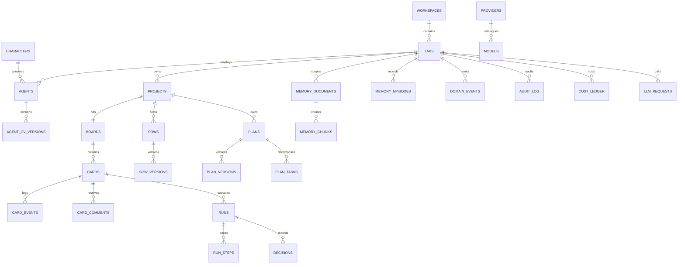

# AI-Lab Database

| Field | Value |
|---|---|
| Document | `docs/database.md` |
| Version | 1.0.0 |
| Status | Accepted |
| Owner | Dev |
| Canonical DDL | `.docs/technical-specification/APPENDIX-A-DATABASE.sql` |
| Migrations | `migrations/0001_init.sql`, `migrations/0002_analytics_views.sql` |
| Related | `docs/data-ownership.md`, `docs/metrics.md`, `.docs/DATA-MODEL.md` |

PostgreSQL 18 with pgvector is the only durable system of record. Redis is cache and ephemeral coordination. This document explains the schema, indexes, migration policy, retention and integrity rules.

---

## 1. Entity relationship overview



## 2. Table dictionary

### Platform and tenancy

| Table | Purpose | Key rules |
|---|---|---|
| `workspaces` | Tenancy root, single-tenant v1 | `slug` unique; one seeded default workspace |
| `labs` | Lab workspace | `(workspace_id, slug)` unique; autonomy 0–3; budget ≥ 0 |
| `app_settings` | Global settings | key/value JSONB |
| `maintenance_jobs` | Scheduled jobs | `name` unique; cron + enabled |
| `audit_log` | Append-only audit | indexes on lab/time and action/time |
| `cost_ledger` | Micro-USD cost ledger | canonical cost source |
| `llm_requests` | LLM usage ledger | tokens, cost, latency, status |
| `outbox` | Transactional outbox | partial index on unpublished |
| `domain_events` | Durable event log | `(lab_id, seq)` unique |

### Inventory

| Table | Purpose | Key rules |
|---|---|---|
| `providers` | LLM vendor endpoint | encrypted key; `kind` check |
| `models` | Model catalog | `(provider_id, name)` unique; costs ≥ 0 |
| `scm_credentials` | GitHub credential | encrypted token; workspace-scoped |
| `characters` | Finite 10-character roster | seeded slugs |
| `agents` | Persistent employees | one active Tech Lead per lab; description 120–600 |
| `agent_cv_versions` | Append-only CV | `(agent_id, version)` unique |
| `projects` | GitHub-connected project | key prefix regex; unique per lab |

### Knowledge and memory

| Table | Purpose | Key rules |
|---|---|---|
| `memory_documents` | Scoped documents | lab/project/agent scope consistency |
| `memory_chunks` | 800-token chunks + 384-d vectors | `(document_id, ordinal)` unique; HNSW cosine |
| `memory_episodes` | Episodic memory | lab-scoped; compaction index |

### Kanban

| Table | Purpose | Key rules |
|---|---|---|
| `boards` | One board per project | `project_id` unique |
| `cards` | Work item | column/priority/estimate checks; READY/REVIEW/DONE guards; reviewer ≠ assignee |
| `card_events` | Immutable transition log | `(card_id, seq)` unique |
| `card_comments` | Comments | lab-scoped via the card |

### Delivery

| Table | Purpose | Key rules |
|---|---|---|
| `sows`, `sow_versions` | Versioned SOW | status check; `(sow_id, version)` unique |
| `plans`, `plan_versions` | Versioned plan DAG | graph JSONB; `(plan_id, version)` unique |
| `plan_tasks` | WBS leaves | `(plan_id, version, task_key)` unique |
| `runs` | One attempt per card | `(card_id, attempt)` unique; status check |
| `run_steps` | Typed run trace | `(run_id, seq)` unique |
| `decisions` | Decision records | project/time index |

### SCM integration

| Table | Purpose | Key rules |
|---|---|---|
| `github_webhook_deliveries` | Webhook idempotency | delivery ID primary key; unprocessed index |

## 3. Index rationale

- Every foreign key is indexed where it is queried (for example `idx_cards_board_column`, `idx_runs_card`).
- Partial indexes target hot subsets: `idx_cards_assignee WHERE column_name IN ('READY','DOING')`, `idx_outbox_unpublished WHERE published_at IS NULL`, `idx_runs_status_heartbeat WHERE status = 'running'`.
- GIN indexes cover arrays and full-text (`labels`, `tsv`) and trigram title search.
- HNSW (`vector_cosine_ops`, `m=16`, `ef_construction=64`) covers memory embeddings; query-time `hnsw.ef_search` is tunable.
- The analytics views are read-only and never add write indexes to base tables.

## 4. Migration policy

- Forward-only sqlx migrations named `NNNN_description.sql`.
- Never edit an applied migration; corrections are new migrations.
- Expand/contract for destructive changes: add, dual-write, backfill in ≤5,000-row batches, switch reads, then drop in a later release.
- Create large indexes `CONCURRENTLY`; set `lock_timeout` for DDL on live tables.
- `migrate` is a one-shot Compose service; failure blocks api/worker by design.
- No down migrations; recovery is restore plus a forward fix.

```bash
make migrate          # apply migrations through the Compose service
.tools/test-migrations.sh   # schema diff against Appendix A
```

## 5. Redis contract

Redis is cache and ephemeral coordination only. Every key is namespaced `ailab:{env}:...` and every key has a TTL.

| Key | TTL | Purpose |
|---|---|---|
| `cache:retrieval:{hash}` | 300 s | Retrieval cache |
| `cache:embedding:{hash}` | 24 h | Embedding cache |
| `work:{run_id}:messages` | 2 h | Working memory, last 40 |
| `rl:{scope}:{id}:{window}` | window | Rate limiting (fail closed) |
| `lock:{name}` | operation | Locks (`SET NX PX` + Lua release) |
| `presence:agent:{id}` | 60 s | Presence |
| `budget:{lab}:{day}` | 48 h | Fast budget check |
| `events` | — | Pub/sub fan-out |

The key builder and TTL constants are in `crates/infrastructure/src/redis_keys.rs`.

## 6. Retrieval and scope isolation

- Scope filtering happens in `WHERE` before ranking; application post-filtering alone is a P0 defect.
- Hybrid score: `0.7 * (1 - cosine_distance) + 0.3 * ts_rank_cd(tsv, query)` with recency decay and scope boost.
- Deduplicate at cosine ≥ 0.92 within the same scope.
- Embedding dimension is fixed at 384; a change requires a new table, a backfill and an ADR.
- The HNSW function and retrieval evaluation land with WP-08; the schema and indexes are ready.

## 7. Retention and compaction

| Data | Retention | Mechanism |
|---|---|---|
| `domain_events` | 180 days | archive, then delete |
| `card_events` | 2 years | archive after 1 year |
| `run_steps` | 180 days | summarize into `runs.result_summary` |
| `memory_episodes` | 180 days raw | daily compaction at 03:00 UTC |
| `llm_requests` | 90 days payload, 2 years ledger | redact payload, keep aggregates |
| `audit_log` | 2 years | archive, append-only |
| `outbox` published | 7 days | delete |
| `github_webhook_deliveries` | 30 days | delete processed |

The retention SQL jobs are wired to `maintenance_jobs` in WP-23/WP-20.

## 8. Seed data

- `0001_init.sql` seeds the default workspace, the 10 characters and 7 maintenance jobs.
- `scripts/seed-demo.sql` seeds the deterministic demo: 1 lab, 4 agents, 1 project, 1 board, 1 SOW, 1 plan, 12 cards and 36 card events. It is idempotent by fixed UUIDs and `ON CONFLICT`.
- `make seed-demo` applies it to the running database.

## 9. Integrity and backups

```bash
scripts/integrity-check.sh                         # report-only checks; fails on any finding
make backup                                        # dump + artifact tar + manifest
make restore-drill BACKUP=artifacts/backups/<dump> # restore into a scratch DB and compare counts
```

Integrity checks cover card projection vs latest event, DoR on READY, merge SHA on DONE, reviewer separation on REVIEW, orphan cards, stuck outbox and null embeddings. A deliberately corrupted projection makes the check exit non-zero.

## 10. Test suites

```bash
.tools/test-migrations.sh      # migrations reproduce Appendix A exactly
.tools/test-constraints.sh     # CHECK/UNIQUE negatives + optimistic concurrency
.tools/test-analytics-views.sh # 25 analytics assertions on fixed fixtures
scripts/integrity-check.sh     # live integrity report
make db-check                  # all of the above
```

The performance suite (2,000 cards / 100k events, p95 budgets) and the HNSW retrieval evaluation are delivered with WP-08/WP-21.

## 11. References

- `.docs/technical-specification/APPENDIX-A-DATABASE.sql`
- `.docs/technical-specification/AI-LAB-TECHNICAL-SPECIFICATION.md` §14, §17
- `.docs/DATA-MODEL.md`, `docs/data-ownership.md`, `docs/metrics.md`
- `.docs/sow/WP-04-DATA-PLATFORM.md`
