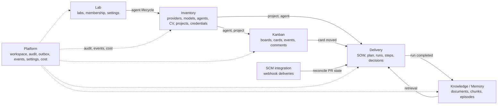

# AI-Lab Domain Model

| Field | Value |
|---|---|
| Document | `docs/domain-model.md` |
| Version | 1.0.0 |
| Status | Accepted |
| Owner | Analyst |
| Source of truth | `.docs/technical-specification/AI-LAB-TECHNICAL-SPECIFICATION.md` §6 |
| Related | `docs/architecture.md`, `docs/data-ownership.md`, `.docs/DATA-MODEL.md` |

AI-Lab is modelled as five bounded contexts plus Platform. Each context owns its aggregates, invariants, tables and events. Aggregates protect invariants in constructors and methods; invalid states are unrepresentable. The database schema is in `.docs/technical-specification/APPENDIX-A-DATABASE.sql`.

---

## 1. Context map

## 2. Inventory context

### 2.1 Provider

Aggregate root: `Provider`. A configured LLM vendor endpoint.

Invariants:

1. `kind` is `deepseek` in v1; the port allows more providers later.
2. API keys are encrypted at rest with AES-256-GCM using `AILAB_MASTER_KEY`; only `api_key_last4` is readable.
3. Keys are write-only: no API response returns the plaintext after creation.
4. Health is probed every 60 s; failures move the status to `degraded`.
5. Rate limits are a Redis token bucket per provider and per lab; exhaustion queues, never fails.

### 2.2 Model

Aggregate root: `Model` (child of `Provider`).

Invariants:

1. v1 seeds exactly `deepseek-flash` (default) and `deepseek-v4-pro` (escalation).
2. Cost per million tokens is configuration, never hardcoded.
3. Every LLM request records input, output and cached tokens and computes cost from the model row at request time.

### 2.3 Agent and CV

Aggregate root: `Agent`; entity `AgentCvVersion`.

Invariants:

1. Roles are fixed: `tech_lead`, `analyst`, `dev`, `qa`. Exactly one active Tech Lead per lab is mandatory.
2. Each agent has exactly one character from the finite roster; the character affects presentation only, never permissions.
3. `description` is 120–600 characters and describes capabilities, not identity.
4. `max_concurrent_cards` defaults to 1 and is between 1 and 4.
5. CV history is append-only; the current CV is the highest version. A completed card appends evidence.
6. Lifecycle: `created → active → paused → retired`. A retired agent keeps CV and history, receives no new cards, and remains visible as an empty desk.

### 2.4 Project and SCM credential

Aggregate root: `Project`; entity `ScmCredential`.

Invariants:

1. A project belongs to exactly one lab; moving it requires an audited transfer.
2. `key_prefix` matches `^[A-Z][A-Z0-9]{1,9}$` and is unique within the lab.
3. GitHub tokens live in `scm_credentials`, never in project rows.
4. `source_ref` is `owner/repo`; `default_branch` defaults to `main`.

## 3. Lab context

Aggregate root: `Lab`; entity `TeamMembership`.

Invariants:

1. A lab owns exactly one Tech Lead, zero or more Analyst/Dev/QA agents, zero or more projects and three-tier memory.
2. Autonomy is `A0|A1|A2|A3`; A2 is the default; A3 requires explicit opt-in and a hard monthly budget.
3. Budget settings are per card and per day; `hard_stop` defaults to true.
4. Lab settings are validated against a JSON Schema; unknown keys are rejected.
5. WIP limits default to one `DOING` card per agent and three `REVIEW` cards per QA.

## 4. Knowledge and Memory context

Aggregate root: `MemoryDocument`; entities `MemoryChunk`, `MemoryEpisode`.

Invariants:

1. Exactly three scopes: lab, project, agent. No global scope in v1.
2. Chunks are 800 tokens with 15% overlap; embeddings are 384-dimensional.
3. Retrieval is scope-filtered in SQL before ranking; post-filtering alone is a P0 defect.
4. Hybrid ranking: pgvector cosine (0.7) + full-text rank (0.3) with recency decay and scope boost; top-k defaults to 8.
5. Every retrieval is logged with query, scopes, chunk IDs and scores.
6. Secrets and PII are scrubbed before embedding and before any LLM call.
7. Episodes older than 180 days are deleted unless pinned; daily compaction summarizes episodes older than 30 days.

## 5. Kanban context

Aggregate root: `Board` and `Card`; entities `CardEvent`, `CardComment`.

Invariants:

1. Every project has exactly one board with exactly six columns in order: `TODO`, `READY`, `DOING`, `REVIEW`, `DONE`, `ICEBOX`.
2. Card keys `{PROJECT_KEY}-{seq}` are allocated by a Postgres sequence and never reused.
3. The transition matrix in `.docs/technical-specification/APPENDIX-C-AGENTS-KANBAN.md` §C.3 is enforced server-side; same-column transitions are denied.
4. `TODO → READY` requires complete DoR; `REVIEW → DONE` requires QA approval, a merged PR, a merge SHA and complete DoD.
5. `DOING` has exactly one assignee; `REVIEW` requires a reviewer different from the assignee.
6. Every transition writes an immutable `card_event` with `seq`; the card column is a projection of the latest event.
7. Optimistic concurrency is enforced by `version`; stale writes return `409`.
8. Agents may create only `TODO` cards and never `READY` directly.
9. Reopening a `DONE` card creates a new card with a parent link; the old card keeps its audit trail.

## 6. Delivery context

Aggregates: `Sow`, `Plan`, `Run`, `Decision`; entities `SowVersion`, `PlanVersion`, `PlanTask`, `RunStep`.

Invariants:

1. A SOW is versioned and has mandatory sections: executive summary, objectives, scope in/out, stakeholders, functional and non-functional requirements, architecture, milestones, deliverables, acceptance criteria, assumptions, risks, timeline, budget, governance, change control.
2. A plan is a DAG; cycles are rejected at validation.
3. Materialization converts WBS leaves to `TODO` cards, preserving parent and SOW links.
4. A run is one attempt by one agent on one card; `(card_id, attempt)` is unique.
5. Run status is `queued|running|succeeded|failed|cancelled|timed_out`.
6. Run steps are ordered and typed: `plan`, `tool_call`, `llm_request`, `command`, `test`, `commit`, `push`, `pr`, `review`, `decision`, `roadblock`, `handoff`, `verification`, `reflection`.
7. A decision records context, decision, alternatives, consequences and reversibility; run decisions are promoted to memory as ADR candidates.
8. Merge requires separation of duties: reviewer ≠ author and merger ≠ author.

## 7. Platform context

Aggregates: `Workspace`, `AuditEntry`, `OutboxMessage`, `DomainEvent`, `AppSetting`, `CostEntry`, `LlmRequest`, `MaintenanceJob`.

Invariants:

1. Every mutation has an actor, a correlation ID and, for agentic work, a `run_id`.
2. Outbox rows are written in the same transaction as the state change.
3. Domain events carry a per-lab monotonic `seq`.
4. Cost entries are the canonical cost source; `runs.cost_microusd` is a projection.
5. Maintenance jobs are idempotent and report-only unless explicitly destructive.
6. The workspace is the tenancy root; v1 seeds one default workspace; it cannot be deleted while it contains active labs.

### 7.1 SCM integration context (adapter)

Aggregate root: `WebhookDelivery`.

Invariants:

1. The delivery identifier is unique; duplicates are acknowledged without reprocessing.
2. The payload is verified with HMAC before acceptance.
3. Status is `received`, `processed`, `ignored` or `failed`.
4. Reconciliation of PR and repository state is delegated to Delivery and Kanban; the adapter owns only the webhook idempotency state.

## 8. Event catalog (core)

| Event | Producer | Key payload |
|---|---|---|
| `inventory.agent.created` | Inventory | `agent_id`, `role`, `character_id` |
| `inventory.agent.cv_updated` | Inventory | `agent_id`, `version`, `skills_delta` |
| `inventory.project.connected` | Inventory | `project_id`, `source_ref`, `default_branch` |
| `lab.agent.status_changed` | Lab | `agent_id`, `from`, `to`, `reason` |
| `kanban.card.created` | Kanban | `card_id`, `key`, `column`, `source` |
| `kanban.card.moved` | Kanban | `card_id`, `from`, `to`, `actor`, `reason` |
| `kanban.card.updated` | Kanban | `card_id`, `changed_fields` |
| `kanban.card.blocked` | Kanban | `card_id`, `category`, `reason` |
| `delivery.run.queued` | Delivery | `run_id`, `card_id`, `agent_id` |
| `delivery.run.started` | Delivery | `run_id`, `lease_id` |
| `delivery.run.step` | Delivery | `run_id`, `step_type`, `summary` |
| `delivery.run.completed` | Delivery | `run_id`, `status`, `cost_usd` |
| `delivery.pr.opened` | Delivery | `card_id`, `pr_url`, `branch` |
| `delivery.review.submitted` | Delivery | `card_id`, `reviewer_id`, `verdict` |
| `delivery.merge.completed` | Delivery | `card_id`, `sha`, `merged_by` |
| `memory.document.created` | Memory | `scope`, `scope_id`, `document_id` |
| `memory.compaction.completed` | Memory | `scope`, `documents_created`, `episodes_removed` |
| `system.budget.exhausted` | Platform | `lab_id`, `scope`, `limit_usd`, `spent_usd` |
| `system.health.changed` | Platform | `component`, `status`, `detail` |

The full AsyncAPI contract is in `docs/api/asyncapi.json` (WP-16) and Appendix B.2.

## 9. Cross-context interactions

| Interaction | From → To | Mechanism |
|---|---|---|
| Agent lifecycle | Lab → Inventory | application command through a port |
| Project and agent references | Inventory → Kanban, Delivery | `*_id` references, never joins |
| Card movement | Kanban → Delivery | `kanban.card.moved` event |
| Run outcome | Delivery → Memory, Kanban | `delivery.run.completed` event / projection |
| Retrieval | Delivery → Memory | application query port with scope |
| Audit and cost | All → Platform | same-transaction outbox / ledger writes |

## 10. Invariant enforcement summary

| Area | Enforced by |
|---|---|
| Provider key secrecy | encryption + write-only DTO + tests |
| Exactly one Tech Lead | partial unique index + domain validation |
| CV append-only | versioned insert-only table + service rule |
| Memory scope isolation | SQL scope filter + leakage test |
| Kanban matrix, DoR, DoD, WIP | server-side engine + integration tests |
| Optimistic concurrency | `version` column + `409` |
| Plan acyclicity | validator + property test |
| Run uniqueness | `(card_id, attempt)` unique constraint |
| Separation of duties | server check + `422 SEPARATION_OF_DUTIES` |
| Event ordering | per-lab `seq` + outbox |
| Auditability | `audit_log` with actor and trace |

## 11. Kernel primitives

The kernel in `crates/domain` and `crates/application` makes invalid states unrepresentable and every mutation eventful.

| Primitive | Representation | Invariant |
|---|---|---|
| `WorkspaceId`, `LabId`, `AgentId`, `ProjectId`, `CardId`, `RunId`, `SowId`, `PlanId`, `DocumentId`, `ChunkId` | Newtype over `Uuid` | Non-nil; UUIDv7 when generated |
| `CardKey` | `{prefix}-{seq}` | Prefix `[A-Z][A-Z0-9]{1,9}`; seq > 0 |
| `Slug` | lowercase ASCII `[a-z0-9-]`, 2–64 | no leading/trailing `-` |
| `Money` | `i64` micro-USD | non-negative; checked add/sub |
| `Version` | `u32` | ≥ 1; increments by 1 |
| `Estimate` | `u8` | 1,2,3,5,8,13; 13 requires split |
| `AutonomyLevel` | `A0..A3` | effective = min(lab, card, agent) |
| `Actor` | `{type, id?}` | agent actors require an id |
| `ContentHash` | `sha256:<hex>` | lowercase 64-hex digest |
| `Secret<T>` | wrapper | Debug/Display/Serialize never leak |
| `DomainEvent` | envelope | known catalog type + object payload |

Ports (in `crates/application/src/ports.rs`): `Repository<A>`, `Clock`, `IdGenerator`, `EventBus`, `Outbox`, `TransactionManager`. The aggregate contract is `Aggregate` in `crates/domain/src/aggregate.rs`.

## 12. References

- `.docs/technical-specification/AI-LAB-TECHNICAL-SPECIFICATION.md` §6
- `.docs/technical-specification/APPENDIX-A-DATABASE.sql`
- `.docs/technical-specification/APPENDIX-C-AGENTS-KANBAN.md` §C.3
- `.docs/DATA-MODEL.md`
- `.docs/sow/WP-01-ARCHITECTURE.md`, `.docs/sow/WP-06-DOMAIN-KERNEL.md`
