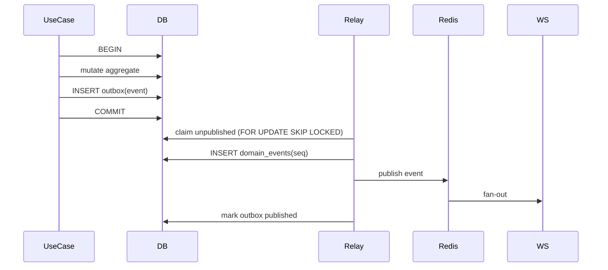

# AI-Lab Eventing

| Field | Value |
|---|---|
| Document | `docs/eventing.md` |
| Version | 1.0.0 |
| Status | Accepted |
| Owner | Dev |
| Related | `docs/domain-model.md`, `docs/contracts.md`, `crates/domain/src/event.rs` |

AI-Lab uses a transactional outbox and a durable event log. Every state change that other contexts care about emits a domain event in the same transaction as the aggregate write.

---

## 1. Envelope

| Field | Meaning |
|---|---|
| `event_id` | UUIDv7; unique and the consumer dedupe key |
| `event_type` | Catalog name (`kanban.card.moved`) |
| `lab_id` | Lab scope |
| `seq` | Per-lab monotonic sequence, assigned on commit |
| `occurred_at` | Server UTC timestamp |
| `actor` | `human`, `agent` (with id) or `system` |
| `payload` | JSON object; schema versioned |
| `schema_version` | Catalog version (currently 1) |

`DomainEvent::new` rejects unknown event types and non-object payloads. `assign_seq` rejects non-positive sequences.

## 2. Catalog

The catalog is `EVENT_CATALOG` in `crates/domain/src/event.rs` and currently has 26 entries across Inventory, Lab, Kanban, Delivery, Memory, System and Security. `golden_events()` in `crates/testkit` produces one valid event per entry; the test asserts the count and payload shape. The full AsyncAPI schema is generated by WP-16.

## 3. Outbox flow



Invariants:

1. The aggregate row and its outbox rows commit or roll back together.
2. `event_id` is unique; a duplicate append is ignored.
3. `seq` is strictly increasing per lab with no gaps for committed events.
4. The relay delivers at-least-once; consumers deduplicate by `event_id` and apply by `seq`.
5. Published outbox rows are retained 7 days, then deleted.

The in-memory outbox in `crates/infrastructure/src/outbox.rs` proves sequencing, dedupe and at-least-once semantics; the Postgres adapter and relay land with WP-13.

## 4. Transaction boundary

- One transaction per use case.
- Cross-context side effects are events, never direct writes.
- Long jobs checkpoint to `runs`/`run_steps`; they never hold a transaction open across an LLM, SCM or sandbox call.
- Optimistic concurrency uses `version`; a stale save is `409 VERSION_CONFLICT`.

## 5. Idempotent consumers

A consumer keeps the last applied `seq` per lab and a seen `event_id` set (or a unique insert guard). A duplicate delivery is acknowledged without reprocessing. A gap triggers a backfill from `GET /api/v1/events?after=` (WP-16).

## 6. Schema versioning

- Adding an optional field is non-breaking; bump `schema_version` only when the shape changes in a way consumers must know.
- Removing or renaming a field requires a new event type or a versioned migration.
- Every catalog entry has a golden payload; a mismatch fails the test suite.

## 7. Testing

```bash
cargo test -p ailab-domain
cargo test -p ailab-infrastructure
cargo test -p ailab-testkit
.tools/check-crate-dependencies.sh
```

Coverage: catalog size and validity, event round-trip, sequence assignment, per-lab sequences, duplicate dedupe, at-least-once until acknowledged, golden fixtures, optimistic-concurrency conflict.

## 8. References

- `.docs/technical-specification/AI-LAB-TECHNICAL-SPECIFICATION.md` §13, §14.3, §15.3
- `.docs/technical-specification/APPENDIX-B-CONTRACTS.md` §B.2
- `crates/domain/src/event.rs`, `crates/infrastructure/src/outbox.rs`, `crates/testkit/src/fixtures.rs`
- `.docs/sow/WP-06-DOMAIN-KERNEL.md`
